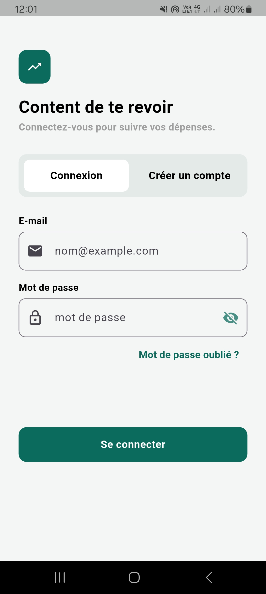
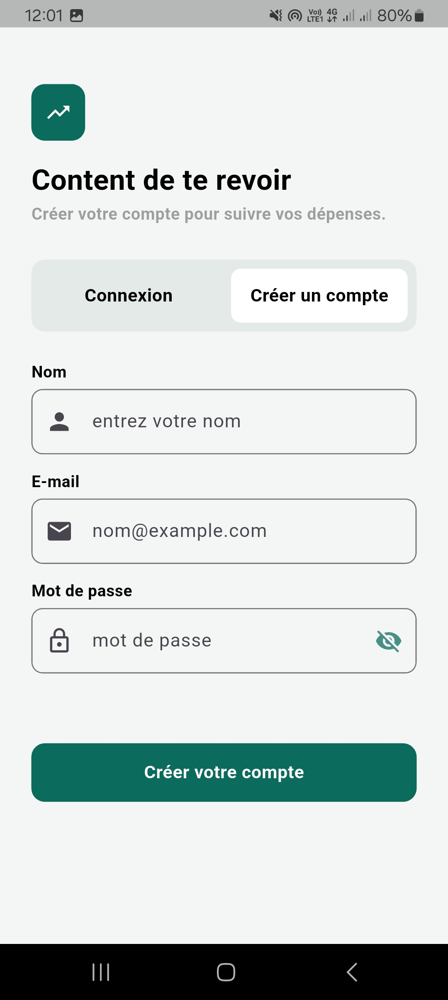
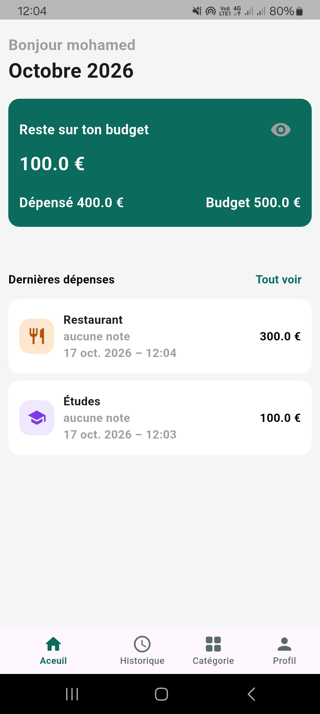
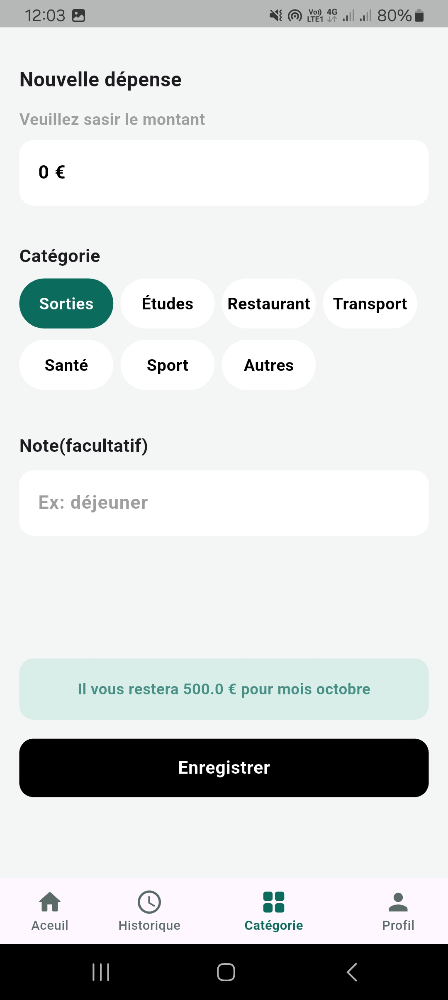
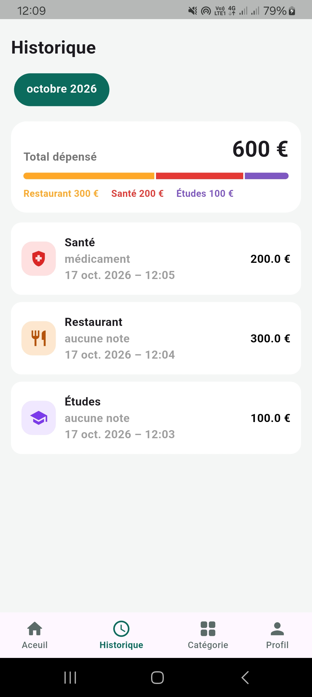
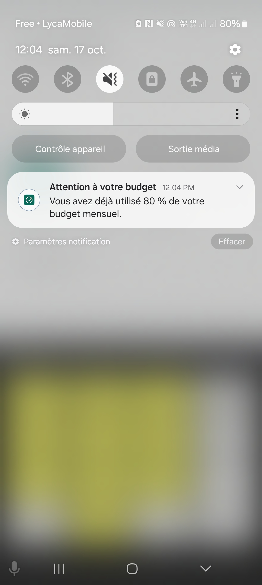

# Mes Dépenses
 Application mobile Flutter permettant de gérer efficacement son budget personnel et de suivre ses dépenses mensuelles.

# Description
 Mes Dépenses aide les utilisateurs à mieux gérer leurs finances en définissant un budget mensuel, en enregistrant leurs dépenses et en visualisant leur consommation grâce à des statistiques et des graphiques.

# Fonctionnalités
- Création et gestion d'un budget mensuel personnalisé
- Ajout de dépenses
- Classement des dépenses par catégorie
- Historique des dépenses par mois
- Visualisation graphique des dépenses mensuelles
- Calcul automatique du budget restant
- Notification lorsque 80 % du budget est atteint
- Notification lors du dépassement du budget
- Gestion multilingue (Français et Anglais)
- Interface responsive adaptée à différentes tailles d'écran

# Technologies utilisées
- Flutter
- Dart
- Firebase Authentication
- Cloud Firestore
- Provider
- Flutter Local Notifications
- Flutter Localization
- Git

# Démonstration
Cette vidéo présente la version actuelle de l'application.

 Vidéo YouTube : https://youtube.com/shorts/j7BnbQcGEMQ

Pour découvrir l'application en détail, vous pouvez consulter la vidéo de démonstration ci-dessus. Vous trouverez également ci-dessous quelques captures d'écran présentant les principales interfaces de l'application.

  
  &nbsp;&nbsp;&nbsp;
  

  
  &nbsp;&nbsp;&nbsp;
  

  
  &nbsp;&nbsp;&nbsp;
  

# Auteur
Mohamed ESSA

# Licence
Copyright © 2026 Mohamed ESSA

Tous droits réservés.

Ce projet est publié exclusivement à des fins de démonstration et de portfolio.

Toute reproduction, modification, redistribution ou utilisation commerciale de ce projet sans l'autorisation écrite préalable de l'auteur est interdite.